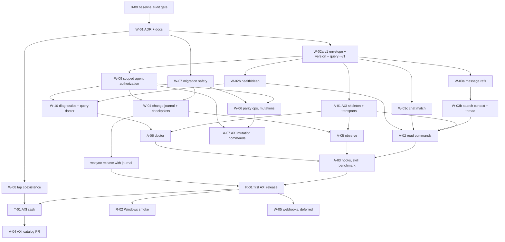

# Platform roadmap

This is the historical implementation plan from 2026-10-19. Repository labels,
separate release milestones and the AXI cask proposal below describe that plan,
not the current distribution layout. [ADR-002](ADR-002-monorepo.md) supersedes
those decisions; the [common release guide](../releasing.md) owns the current
coordinated pipeline.

## Dependency graph

---

## Ordered backlog

Rules for every wasync PR: CI green on Linux, macOS, Windows and MSIX; existing `/api/*`, `wasync query` default output and TUI unchanged (golden snapshots prove it); no migration unless listed; release-safe on its own under the [current release policy](../releasing.md).

| # | ID | Repo | Deliverable | Depends | Tests | Acceptance |
|---|---|---|---|---|---|---|
| 0 | **B-00** | WhatsappTuiCli | Baseline audit: CI run on current main (all OS jobs), golden snapshots of every legacy `/api/*` response and `wasync query` output, fixture archives at schema 1–5, recorded results | – | existing suite + new snapshot tests | all green and recorded; gate for repo creation and releases |
| 1 | **W-01** | WhatsappTuiCli | ADR-001, API inventory, parity matrix, threat model, dependency graph under `docs/architecture/` | B-00 | docs only | no code diff |
| 2 | **W-02a** | WhatsappTuiCli | `/api/v1` router, envelope + `request_id`, `GET /api/v1/version`, `wasync query version`, `--v1` envelope mode for `query`, golden contract fixtures | W-01 | handler + CLI golden tests, legacy snapshots unchanged | both transports return identical v1 shapes for the same archive |
| 3 | **W-07** | WhatsappTuiCli | Backup (`VACUUM INTO`) before migrating past 5; `query` accepts newer additive schemas it understands; documented downgrade | W-01 | fixtures v1–v5 migrate; backup once; older binary reads newer additive archive | reinstalling the previous release still reads the archive |
| 4 | **W-08** | WhatsappTuiCli | `publish-tap.sh` stops overwriting tap README wholesale (or README carries both apps from source), rebase-and-retry push, shared concurrency group | W-01 | dry run against a temp clone with a second cask | `Casks/wasync.rb` unchanged; another cask survives a wasync release |
| 5 | **W-09** | WhatsappTuiCli | Scoped agent clients: `wasync agents grant|list|revoke` (TTY/TUI only), hashed credentials file, scope + chat allowlist + rate limit + expiry middleware for `/api/v1`, audit log, `GET /api/v1/whoami` | W-02a | each scope allowed/denied, allowlist, expiry, rate limit, no grant over API, audit has no bodies, legacy tokens unaffected | an AXI credential cannot do anything its grant omits, whatever flags AXI passes |
| 6 | **W-02b** | WhatsappTuiCli | `GET /api/v1/health/deep` + `query status --v1` | W-02a | fake client states, stale observation | never reports connected while reconnecting or stale |
| 7 | **W-03a** | WhatsappTuiCli | ref codec, `ref` on message JSON (additive), `/api/v1/messages/{ref}`, `query message --ref` | W-02a | round-trip/fuzz, cross-account rejection, ref survives purge + re-capture | no migration |
| 8 | **W-03c** | WhatsappTuiCli | `/api/v1/chats?match=`, `query chats --match` | W-02a | exact, prefix, ambiguous, unicode | never auto-picks among equal matches |
| 9 | **W-03b** | WhatsappTuiCli | search `context`, `/thread`, `query search --context`, `query thread` | W-03a | same-timestamp keyset, expired/deleted hidden, chat boundary | bounded ≤20 each side via `archived_messages` |
| 10 | **W-04** | WhatsappTuiCli | Migration 006: `change_journal` + `journal_meta` (epoch, low-water mark) + `consumer_checkpoints`; journal writes in the same tx as `apply`, `PurgeGroup`, `Expire`, `SetEnabled`; `/api/v1/changes`, `/api/v1/checkpoints/{consumer}`; `query changes` | W-07, W-09 | handoff §7 list: crash between commit and read, late history, edit-before-original, revoke-before-original, purge, capture disable, retention expiry, epoch change, multi-account checkpoint isolation, offline read cannot commit | additive only; no bodies in journal; cursors never derived from timestamps |
| 11 | **W-10** | WhatsappTuiCli | `GET /api/v1/diagnostics` + `query doctor --json`: install/distribution, data dir perms, schema, paired yes/no (without connecting), owner and API state, journal state | W-02b, W-09 | each check pass/warn/fail with synthetic fixtures | no secrets or bodies in output |
| 12 | **REL** | WhatsappTuiCli | wasync preview release containing W-02a…W-10 (via the normal pipeline, after your go) | 2–11 | Homebrew E2E, signed verify | existing installs upgrade in place, archive and pairing intact |
| 13 | **A-01** | whatsapp-axi (new, after B-00 + your go) | Go skeleton, version fast path, transport selector (API ↔ `wasync query`), envelope parser, credential loading, [the AXI compatibility matrix](../../axi/internal/compat/compatibility.json), fixture server from W-02a goldens | W-02a | transport fallback, exit codes 0/1/2, no SQLite/WhatsApp imports (lint check) | AXI binary has no sqlite or whatsmeow dependency |
| 14 | **A-02** | whatsapp-axi | home view, `status`, `chats`, `search --context`, `thread`, `message --full`, compact/TOON + `--json` | A-01, W-02b, W-03a/b/c | golden output, truncation, empty states, both transports | AXI principles 1–6, 8–10 |
| 15 | **A-05** | whatsapp-axi | `observe` with cursors, named consumers, `--follow`, explicit ack | A-01, W-04 | resume after restart, cursor_expired path, offline read without commit | no timestamp cursors anywhere |
| 16 | **A-06** | whatsapp-axi | `doctor` | A-01, W-10 | each check rendered with a fix command | covers install, pairing, service, permissions, compatibility, hooks |
| 17 | **A-03** | whatsapp-axi | `setup hooks`, skill, hints, benchmark on synthetic corpus vs `wasync query` | A-02, A-05, A-06 | hook idempotency, benchmark harness | methodology documented |
| 18 | **R-01** | whatsapp-axi | first release (read + observe + doctor), checksums | A-03, REL | release dry run | requires a published wasync with the journal; no signing secret changes without your approval |
| 19 | **T-01** (superseded: `Formula/whatsapp-axi.rb` in this repository, generated by the monorepo release) | homebrew-tap | `Casks/whatsapp-axi.rb` generated by AXI release, E2E for both casks | R-01, W-08 | brew install/upgrade on both arches | `wasync` cask behaviour unchanged |
| 20 | **R-02** | both | Windows ZIP smoke: AXI talks to local wasync API and falls back to `wasync query` | R-01 | Windows runner | no Store claims |
| 21 | **W-05** | WhatsappTuiCli | opt-in webhooks on the journal (HMAC, retries, dead-letter, SSRF guard) | R-01 | per handoff §7 | deferred until after R-01 (implemented afterwards: `internal/webhook`, no migration; positions live in `webhook-state.json`) |
| 22 | **W-06** | WhatsappTuiCli | parity ops one per PR (LID↔PN, reply/quote send, react, edit own, chat state…), each with a scope | W-07, W-09 | per-op TUI/CLI/API + scope tests | destructive stays human-approved |
| 23 | **A-07** | whatsapp-axi | mutation commands mapped 1:1 to W-06 endpoints | W-06 | denied-by-scope tests against fixture server | AXI adds no policy of its own |
| 24 | **A-04** | axi (external) | catalog PR via `no-mistakes` | A-03, T-01 | – | your call to submit |

### Parallel lanes after B-00 passes

- **Wave 1:** W-01, then in parallel W-02a, W-07, W-08.
- **Wave 2 (after W-02a):** W-09, W-02b, W-03a, W-03c in parallel; A-01 can start if you approve the repo.
- **Wave 3:** W-03b (after W-03a), W-04 (after W-07 + W-09), W-10 (after W-02b + W-09); A-02 as its endpoints land.
- **Wave 4:** A-05 and A-06 in parallel, then A-03, then the wasync release and R-01.
- **Later:** W-05, W-06/A-07, T-01, R-02, A-04.

Critical path: B-00 → W-01 → W-02a → W-09 → W-04 → REL → R-01.
